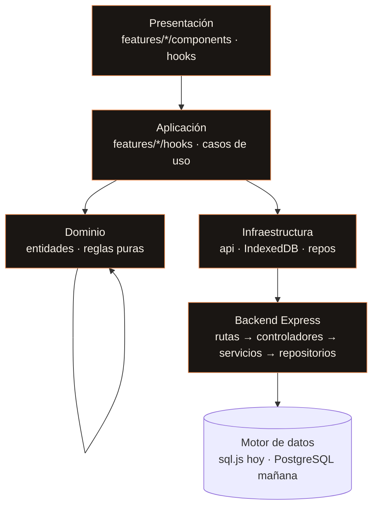

# Arquitectura objetivo · AYNI HEALTH (Fase 2B)

## Diagrama de capas (regla de dependencia unidireccional)



**Regla:** las capas superiores dependen solo de las inferiores. El dominio no importa nada de arriba (sin React, sin I/O).

## Árbol de carpetas objetivo (feature-based)

```
apps/
  web/            # frontend React + Vite
  api/            # backend Express (monolito modular)
packages/
  shared/         # esquemas Zod, contratos, constantes (opcional, npm workspaces)
src/  (equivalente frontend hoy, migrando a feature-based)
  app/            # router, providers, layouts
  shared/         # ui, lib, config
  features/
    auth/
    tripulacion/
    signos-vitales/
    nutricion/
    calendario/
    chat-ia/
      components/
      hooks/
      api/
      schemas/
      tests/
      index.js
```

## Estrategia de migración incremental (strangler)

1. **No reescribir de golpe.** Se introduce la estructura `features/` nueva y se van moviendo módulos uno a uno, manteniendo las rutas y el estado actuales.
2. Orden sugerido: `shared/` → `app/` (router/providers) → `features/tripulacion` → `features/signos-vitales` → resto.
3. Cada feature se extrae con su `index.js` público; las demás features solo la consumen por ese índice.
4. El backend pasa a `rutas → controladores → servicios → repositorios` sin cambiar la capa de datos (el repositorio oculta sql.js).

## Decisiones (ADR cortos)

- **ADR-001 Estado del servidor:** TanStack Query para datos del servidor; Zustand solo para UI (tema, drawer, tripulante activo). Prohibido duplicar datos de servidor en estado local.
- **ADR-002 Formularios:** React Hook Form + Zod con esquemas compartidos front/back.
- **ADR-003 Motor de datos:** repositorios desacoplan sql.js (hoy) de PostgreSQL (Fase 10).
- **ADR-004 Offline-first:** patrón outbox con `idempotency key`; IndexedDB es caché y cola, no fuente de verdad.
- **ADR-005 Sesión (para Fase 3):** JWT corto + refresh rotativo en cookie httpOnly.

## Verificación

- `eslint-plugin-boundaries` valida la regla de dependencia (instalado; la configuración fina se activa al migrar features).
- Presupuesto de bundle por ruta (≤ 200 KB gzip), code-splitting y lazy loading.
- Pirámide de pruebas: unitarias (dominio) → integración (Supertest) → E2E (Playwright).
