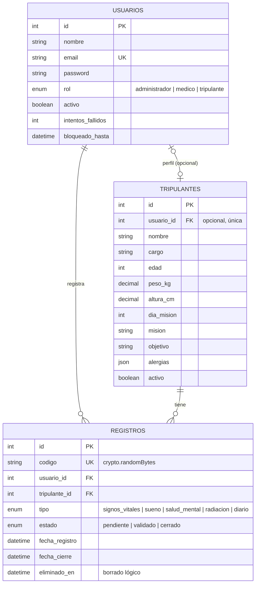

# Diagrama ER · Núcleo (3 tablas)

Las tres tablas núcleo del modelo relacional de AYNI HEALTH. El diagrama completo (36 tablas) se incluye como anexo.

## Relaciones del núcleo

- **USUARIOS 1:N REGISTROS**: un usuario (quien registra) puede crear muchos registros.
- **TRIPULANTES 1:N REGISTROS**: un tripulante acumula muchos registros de salud.
- **USUARIOS 1:1 TRIPULANTES** (opcional): un tripulante puede existir sin cuenta de usuario (los tres actuales no tienen cuenta), o vincularse a una.

---

## Anexo · Modelo ampliado (36 tablas)

### Detalle de registros (1:1 con `registros`)
`signos_vitales`, `registros_sueno`, `evaluaciones_phq9`, `registros_radiacion`, `notas_diario`, `registros_glucosa`, `registros_animo`, `registros_ejercicio`, `registros_sintomas_inmunes`, `registros_estado_conductual`, `registros_ambiente` (cada una con `registro_id` FK).

### Alertas
`alertas` (tripulante_id FK, registro_origen_id FK, severidad, estado).

### Nutrición
`alimentos`, `contramedidas` (alimento_id FK), `planes_nutricionales` (tripulante_id FK), `plan_alimentos` (N:M), `cache_imagenes`.

### Chat de IA
`conversaciones_ia` (usuario_id, tripulante_id FK), `mensajes_ia` (conversacion_id FK, alerta_id FK opcional).

### Reto (catálogo, acciones, rutinas, logros, entornos)
`catalogo_indicadores`, `acciones_salud`, `rutinas_medicion`, `cumplimiento_rutinas`, `logros_tripulante`, `entornos_mision` (con `entorno_id` en `tripulantes`).

### Sistema
`umbrales_clinicos`, `sesiones_refresh`, `auditoria`, `operaciones_sync`, `consentimientos_ia`, `uso_ia`, `configuracion_ia`, `rate_limits` (rate limit persistente).
